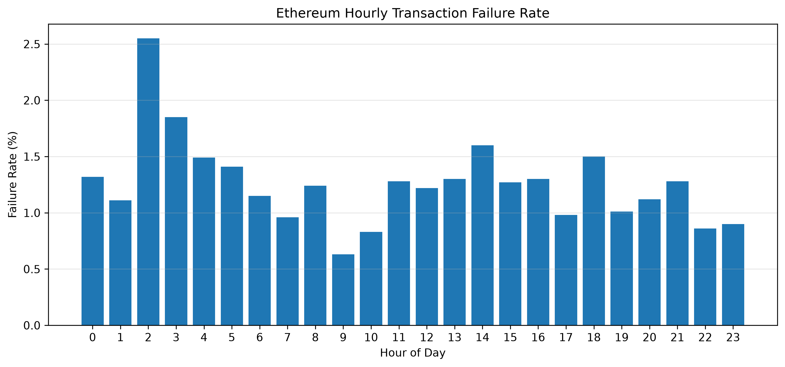
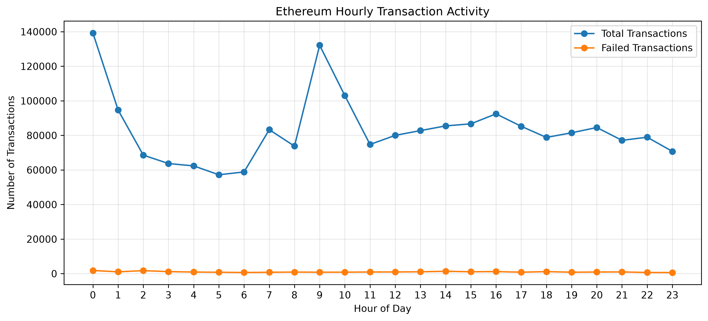
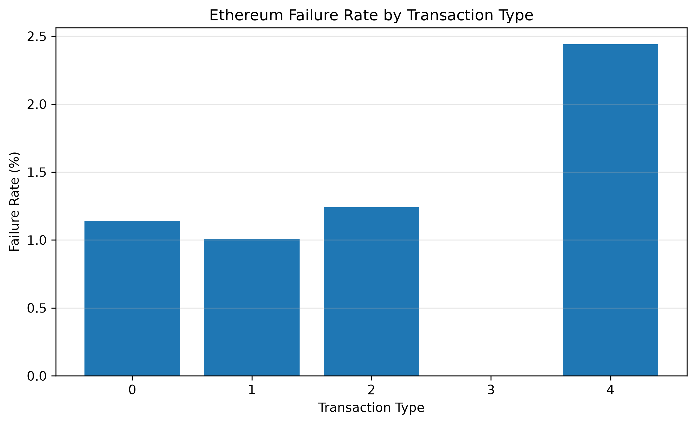
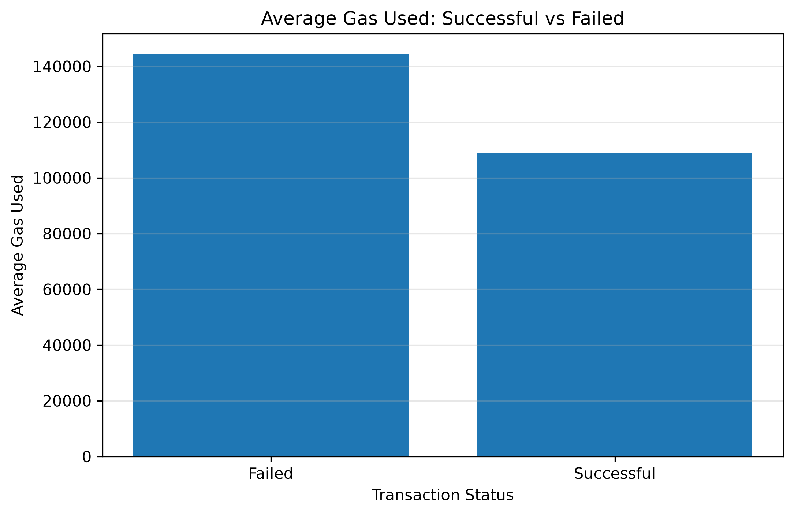
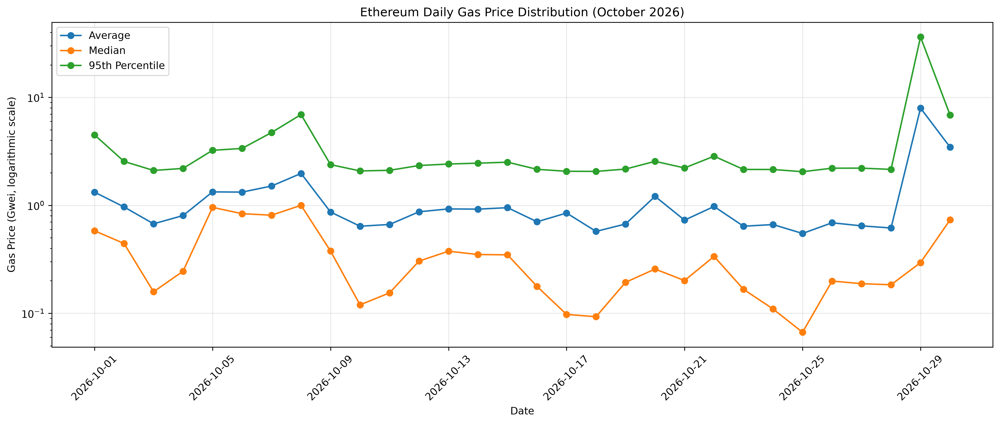
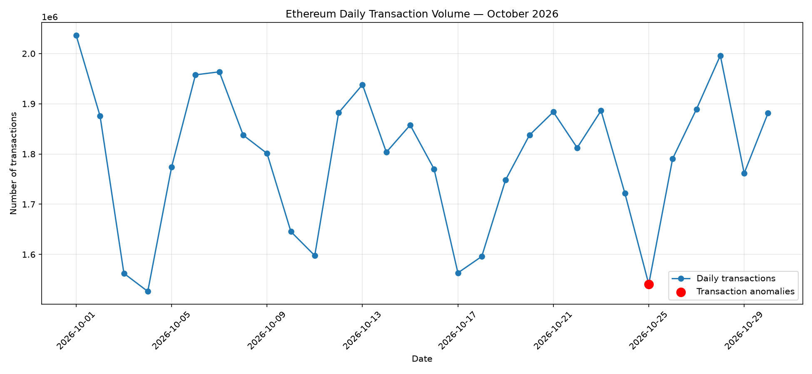
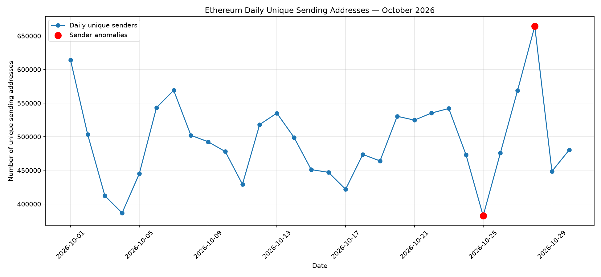

# Ethereum On-Chain Analytics

**A practical blockchain data analytics project using Python, SQL, DuckDB, and AWS Public Blockchain Data.**

[](https://www.python.org/)
[](https://ethereum.org/)
[](https://duckdb.org/)
[](https://aws.amazon.com/s3/)

## 1. Project Overview

This project analyzes Ethereum blockchain transaction data to understand network activity, transaction behavior, gas consumption, and unusual changes in blockchain usage.

It uses Python, SQL, DuckDB, Pandas, and Matplotlib to query and analyze public Ethereum transaction data stored in Amazon S3.

The project demonstrates practical skills in:

- Blockchain and on-chain data analytics
- SQL querying and data aggregation
- Large-scale Parquet data analysis
- Statistical analysis and anomaly detection
- Data visualization and reporting
- Reproducible data analytics workflows

## 2. Project Objectives

- Explore Ethereum transaction data.
- Analyze successful and failed transactions.
- Examine hourly network activity.
- Compare transaction types and failure rates.
- Analyze gas consumption and gas prices.
- Study 30-day Ethereum network activity.
- Identify unusual transaction-volume and sender-activity patterns.
- Query public Parquet datasets directly from AWS S3.

## 3. Technology Stack

| Technology | Purpose |
|---|---|
| Python | Data analysis and processing |
| Pandas | Data manipulation |
| DuckDB | SQL analytics and Parquet querying |
| SQL | Data extraction and aggregation |
| Matplotlib | Data visualization |
| Jupyter Notebook | Interactive analysis |
| AWS S3 | Public blockchain data access |
| Git and GitHub | Version control and documentation |

## 4. Data Source

**Provider:** AWS Public Blockchain Data  
**Blockchain:** Ethereum  
**Format:** Apache Parquet (`.snappy.parquet`)  
**Storage:** Amazon S3

The project queries publicly available Ethereum data directly from S3 using DuckDB.

Public dataset access does not require AWS credentials for the files analyzed in this project.

## 5. Analysis Notebooks

| Notebook | Description |
|---|---|
| [00 - Python Environment Test](notebooks/00_Python_Environment_Test.ipynb) | Verify the Python analytics environment |
| [01 - Ethereum Data Exploration](notebooks/01_Ethereum_Data_Exploration.ipynb) | Explore Ethereum transaction data |
| [02 - Ethereum AWS S3 Analytics](notebooks/02_Ethereum_AWS_S3_Analytics.ipynb) | Query and analyze public Ethereum data in S3 |
| [03 - Ethereum 30-Day Analytics](notebooks/03_Ethereum_30_Day_Analytics_Consolidated.ipynb) | Analyze 30-day gas and network metrics |
| [04 - Ethereum 30-Day Network Activity](notebooks/04_Ethereum_30_Day_Network_Activity.ipynb) | Analyze daily transactions, unique senders, and anomalies |

## 6. Key Findings

### A. One-Day Transaction Analysis

The initial transaction analysis examined Ethereum activity on October 28, 2026.

| Metric | Result |
|---|---:|
| Total transactions | 1,996,106 |
| Successful transactions | 1,971,694 |
| Failed transactions | 24,412 |
| Success rate | 98.78% |
| Failure rate | 1.22% |
| Estimated total transaction fees | 110.4208 ETH |

### B. 30-Day Network Activity Analysis

**Analysis period:** October 1–30, 2026

| Metric | Result |
|---|---:|
| Total transactions | 53,737,985 |
| Successful transactions | 52,983,216 |
| Failed transactions | 754,769 |
| Average daily transactions | 1,791,266 |
| Average daily unique senders | 493,701 |
| Overall success rate | 98.595% |
| Overall failure rate | 1.405% |

### C. Correlation Analysis

| Variables | Correlation |
|---|---:|
| Transactions vs. Unique Senders | +0.859 |
| Transactions vs. Failure Rate | -0.268 |
| Unique Senders vs. Failure Rate | -0.322 |

Transaction volume and unique sending addresses showed a strong positive correlation.

### D. Anomaly Detection

A rolling seven-day Z-score method was used to identify unusual daily activity.

The analysis identified:

| Date | Transaction Anomaly | Sender Anomaly |
|---|---|---|
| October 25, 2026 | Negative | Negative |
| October 28, 2026 | No | Positive |

October 25 showed an unusual decline in both transaction volume and unique sending addresses.

October 28 showed an unusual increase in unique sending addresses.

**Anomaly threshold:** Absolute Z-score greater than or equal to 2.

## 7. Visualizations

### Initial Transaction and Gas Analysis

**Hourly Transaction Failure Rate**



**Hourly Transaction Activity**



**Failure Rate by Transaction Type**



**Gas Used Analysis**



**Daily Gas Price Distribution**



### 30-Day Network Activity and Anomaly Detection

**Daily Transaction Volume Anomalies**



**Daily Unique Sender Anomalies**



## 8. Reports and Analysis Results

The detailed 30-day network activity report is available here:

[Read the 30-Day Network Activity Report](reports/ethereum_30_day_network_activity_report.md)

The anomaly detection results are available here:

[Download/View Network Activity Anomalies CSV](CSVs/ethereum_network_activity_anomalies.csv)

## 9. Project Structure

```text
Ethereum_OnChain_Analytics/
│
├── notebooks/
│   ├── 00_Python_Environment_Test.ipynb
│   ├── 01_Ethereum_Data_Exploration.ipynb
│   ├── 02_Ethereum_AWS_S3_Analytics.ipynb
│   ├── 03_Ethereum_30_Day_Analytics_Consolidated.ipynb
│   └── 04_Ethereum_30_Day_Network_Activity.ipynb
│
├── CSVs/
│   ├── ethereum_daily_gas_distribution.csv
│   ├── ethereum_gas_analysis.csv
│   ├── ethereum_hourly_analysis.csv
│   ├── ethereum_transaction_types.csv
│   └── ethereum_network_activity_anomalies.csv
│
├── visualizations/
│   ├── 01_hourly_failure_rate.png
│   ├── 02_hourly_activity.png
│   ├── 03_failure_rate_by_type.png
│   ├── 04_gas_used.png
│   ├── 05_daily_gas_price_distribution.png
│   ├── 06_transaction_volume_anomalies.png
│   └── 07_unique_sender_anomalies.png
│
├── reports/
│   └── ethereum_30_day_network_activity_report.md
│
├── requirements.txt
├── .gitignore
└── README.md
```

## 10. Installation and Usage

### Requirements

- Python 3.13 or compatible Python version
- Jupyter Notebook
- Internet access for public AWS S3 data queries

### Clone the repository

```bash
git clone https://github.com/jkisfahani/Ethereum_OnChain_Analytics.git
```

```bash
cd Ethereum_OnChain_Analytics
```

### Install dependencies

```bash
python -m pip install -r requirements.txt
```

### Launch Jupyter Notebook

```bash
jupyter notebook
```

Open the notebooks in the `notebooks/` directory.

**Note:** The AWS S3 analytics notebooks require internet access to query public Parquet files. Large raw Parquet datasets are not stored in this GitHub repository.

## 11. Limitations

- A unique sending address does not necessarily represent one individual user.
- Correlation does not establish causation.
- The anomaly detection threshold is exploratory.
- The current network activity analysis covers a 30-day observation period.

Future work can extend the analysis to longer historical periods and investigate smart contract activity, gas-fee behavior, and network congestion.

## 12. Future Improvements

- Extend historical analysis to 90 and 180 days.
- Apply machine learning methods such as Isolation Forest.
- Analyze smart contract and exchange activity.
- Build an interactive Ethereum analytics dashboard.
- Develop an automated daily blockchain monitoring pipeline.

## Author

GitHub: [@jkisfahani](https://github.com/jkisfahani)

## Repository

[https://github.com/jkisfahani/Ethereum_OnChain_Analytics](https://github.com/jkisfahani/Ethereum_OnChain_Analytics)