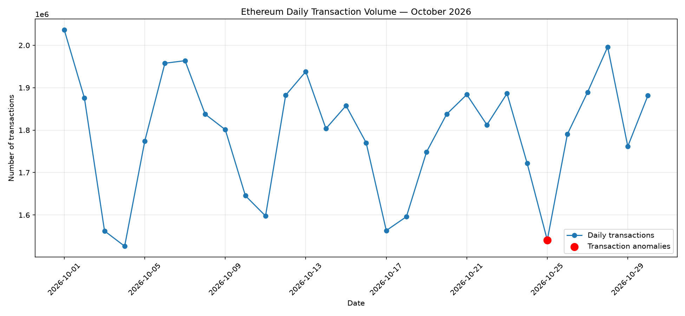
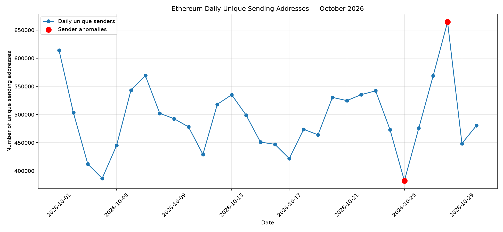

# Ethereum 30-Day Network Activity Analysis Report

**Analysis Period:** October 1–30, 2026  
**Project:** Ethereum On-Chain Analytics  
**Data Source:** AWS Public Blockchain Dataset  
**Storage Format:** Apache Parquet  
**Analysis Tools:** Python, DuckDB, Pandas, Matplotlib

---

## 1. Project Overview

This report examines Ethereum network activity over a 30-day period, from October 1 through October 30, 2026.

The objective is to analyze transaction volume, network participation, transaction failures, and unusual changes in daily activity.

The analysis also applies rolling statistical anomaly detection to identify days with unusually high or low transaction volumes and unique sending addresses.

## 2. Dataset and Methodology

The analysis uses daily Ethereum transaction data from the AWS Public Blockchain Dataset.

Data was queried directly from Amazon S3 in Parquet format using DuckDB. This approach avoids downloading the complete dataset locally.

The analysis covers:

- Daily transaction counts
- Successful and failed transactions
- Unique sending addresses
- Daily transaction failure rates
- Transactions per unique sender
- Correlations between network activity metrics
- Rolling seven-day anomaly detection

The analysis uses daily aggregated observations.

## 3. Overall Network Activity

The following table summarizes Ethereum network activity during the 30-day period.

| Metric | Result |
|---|---:|
| Analysis period | 30 days |
| Total transactions | 53,737,985 |
| Successful transactions | 52,983,216 |
| Failed transactions | 754,769 |
| Average daily transactions | 1,791,266 |
| Average daily unique senders | 493,701 |
| Overall success rate | 98.595% |
| Overall failure rate | 1.405% |

The network processed approximately 53.7 million transactions during the observation period.

Approximately 98.6% of transactions were successful, while 1.4% failed.

## 4. Correlation Analysis

The correlation analysis examined the relationships between daily transaction volume, unique sending addresses, and transaction failure rates.

| Variables | Correlation |
|---|---:|
| Transactions vs. Unique Senders | +0.859 |
| Transactions vs. Failure Rate | -0.268 |
| Unique Senders vs. Failure Rate | -0.322 |

### Key Observations

- Transaction volume and unique sending addresses have a strong positive correlation.
- Transaction volume has a weak negative correlation with the failure rate.
- Unique sending addresses also have a weak negative correlation with the failure rate.

These results describe statistical relationships and do not establish causation.

## 5. Anomaly Detection Methodology

A rolling Z-score method was used to identify unusual daily network activity.

The methodology uses:

- A rolling baseline of the previous seven days.
- The current observation is excluded from its baseline.
- The first seven days are excluded because they do not have enough historical observations.
- An anomaly is identified when the absolute Z-score is greater than or equal to 2.

The Z-score is calculated as:

\[
Z = \frac{X-\mu}{\sigma}
\]

Where:

- \(X\) = Current day's metric
- \(\mu\) = Average of the previous seven days
- \(\sigma\) = Standard deviation of the previous seven days

This method identifies unusually high or low activity relative to recent network behavior.

## 6. Transaction Volume Anomaly

### October 25, 2026

October 25 showed an unusually low transaction volume compared with the previous seven days.

| Metric | Value |
|---|---:|
| Daily transactions | 1,540,685 |
| Previous 7-day average | 1,783,731.71 |
| Transaction Z-score | -2.343 |
| Classification | Negative anomaly |

Transaction volume was approximately 14% below the 30-day daily average.

## 7. Unique Sender Anomalies

Two unusual observations were identified in daily unique sending addresses.

### October 25, 2026

| Metric | Value |
|---|---:|
| Unique senders | 382,357 |
| Previous 7-day average | 506,213.43 |
| Sender Z-score | -3.631 |
| Classification | Negative anomaly |

This was a significant decline in unique sending addresses.

### October 28, 2026

| Metric | Value |
|---|---:|
| Unique senders | 664,339 |
| Previous 7-day average | 500,313.14 |
| Sender Z-score | +2.621 |
| Classification | Positive anomaly |

October 28 showed an unusually high number of unique sending addresses.

## 8. Combined Anomaly Results

The combined analysis identified two anomaly dates.

| Date | Transaction Z-score | Sender Z-score | Classification |
|---|---:|---:|---|
| 2026-10-25 | -2.343 | -3.631 | Both |
| 2026-10-28 | +1.642 | +2.621 | Sender only |

October 25 was unusual in both transaction volume and unique sending addresses.

October 28 was unusual in unique sending addresses, but transaction volume did not cross the anomaly threshold.

### October 25 vs. October 28

| Metric | October 25 | October 28 |
|---|---:|---:|
| Transactions | 1,540,685 | 1,996,106 |
| Unique senders | 382,357 | 664,339 |
| Failure rate | 1.616% | 1.223% |
| Transactions per sender | 4.029 | 3.005 |

October 28 recorded approximately 29.6% more transactions and 73.8% more unique sending addresses than October 25.

## 9. Visualizations

The following charts illustrate the detected anomalies.

### Daily Transaction Volume Anomalies

### Daily Unique Sender Anomalies

## 10. Conclusions

The 30-day analysis provides several observations about Ethereum network activity.

1. Ethereum processed approximately 53.7 million transactions during the observation period.
2. The overall transaction success rate was approximately 98.6%.
3. Daily transaction volume and unique sending addresses showed a strong positive correlation.
4. October 25 experienced an unusual decline in both transaction volume and unique sending addresses.
5. October 28 experienced an unusual increase in unique sending addresses.
6. Rolling statistical analysis provides a useful method for identifying unusual changes in network activity.

These findings demonstrate how public blockchain data can be used to build practical on-chain analytics.

## 11. Limitations and Future Improvements

This analysis has several limitations:

- A sending address does not necessarily represent an individual user. One person may control multiple addresses, and an address may represent a contract, exchange, or automated service.
- Correlation does not establish causation.
- A seven-day rolling baseline may be sensitive to short-term volatility.
- The anomaly threshold is exploratory and should be evaluated against longer historical periods.

Future improvements could include:

- Extending the analysis to 90 or 180 days.
- Detecting anomalies using Isolation Forest.
- Analyzing gas fees and network congestion alongside transaction volume.
- Investigating smart contract and exchange activity.
- Building an automated daily Ethereum monitoring pipeline.

## 12. Reproducibility

The analysis notebook is available in this repository:

`notebooks/04_Ethereum_30_Day_Network_Activity.ipynb`

The anomaly results are available at:

`CSVs/ethereum_network_activity_anomalies.csv`

The visualization files are available in:

`visualizations/`

---

**Project:** Ethereum On-Chain Analytics  
**Repository:** https://github.com/jkisfahani/Ethereum_OnChain_Analytics